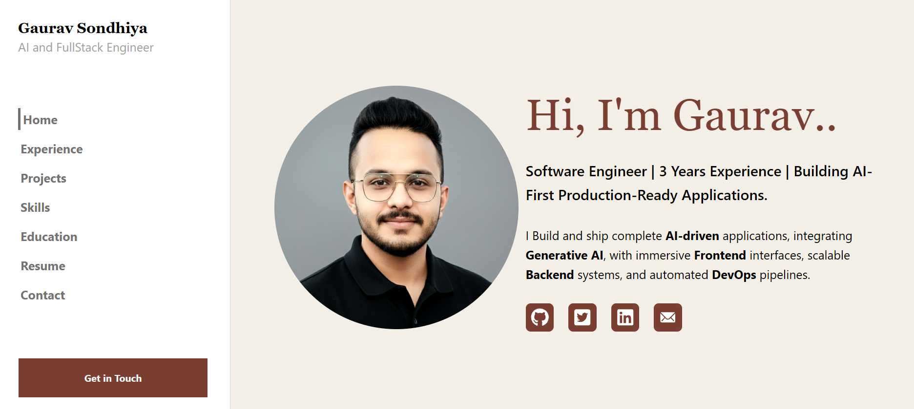

# 🌐 Gaurav Sondhiya — Personal Portfolio

[](https://gauravsondhiya.netlify.app/)
[](https://github.com/gauravsondhiya)
 
 
Welcome to the source repository for my personal developer portfolio, live at **[gauravsondhiya.netlify.app](https://gauravsondhiya.netlify.app/)**. This site showcases my projects, technical skills, development experience, and live GitHub contribution activity.

---

## ✨ Features

- **Editorial & Minimalist Design:** Clean typography paired with a warm terracotta (`#7B3F32`) accent palette.
- **Interactive GitHub Activity:** Live contribution graph powered by `react-github-calendar`.
- **Projects Showcase:** Detailed cards highlighting live demos, source code repositories, and tech stacks.
- **Responsive Layout:** Optimized for seamless viewing across desktop, tablet, and mobile devices.
- **Fast Deployment:** Continuously deployed via Netlify.

---

## 🛠️ Built With

- **Frontend:** React, JavaScript (ES6+)
- **Styling:** Tailwind CSS
- **Components & Integrations:** `react-github-calendar`
- **Hosting & CI/CD:** Netlify

---

## 🚀 Getting Started

To run a local copy of this portfolio on your machine, follow these steps:

### Prerequisites

- Node.js (`v18+` recommended)
- npm or yarn

### Installation

1. **Clone the repository:**
   ```bash
   git clone https://github.com/gauravsondhiya/<your-repo-name>.git
   cd <your-repo-name>
   ```

2. **Install dependencies:**
   ```bash
   npm install
   ```

3. **Start the development server:**
   ```bash
   npm run dev
   ```
   *(Note: Use `npm start` if created with Create React App.)*

4. **Build for production:**
   ```bash
   npm run build
   ```

---

## 📂 Project Structure

```text
├── public/              # Static assets, favicons, and metadata
├── src/
│   ├── assets/          # Images, icons, and resume files
│   ├── components/      # Reusable UI components (Navbar, ProjectCard, GitHubCalendar, etc.)
│   ├── data/            # Portfolio data (projects, skills, experience)
│   ├── App.jsx          # Main application layout
│   └── main.jsx         # Entry point
├── package.json
└── README.md
```

---

## 📬 Connect With Me

- **Portfolio:** [gauravsondhiya.netlify.app](https://gauravsondhiya.netlify.app/)
- **GitHub:** [@gauravsondhiya](https://github.com/gauravsondhiya)


---

## 📄 License

This project is open source and available under the [MIT License](LICENSE).

